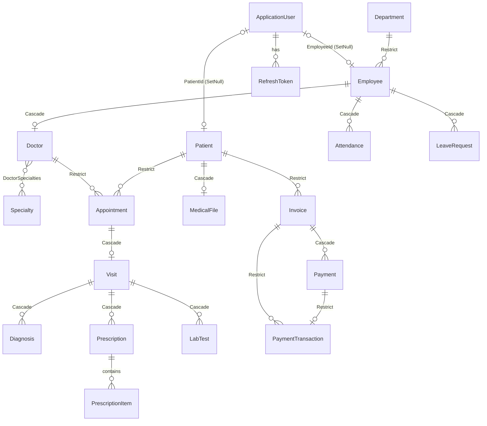

# Clinic Management System: Complete Documentation

**Contents**

1. [Overview](#part-1-overview)
2. [Architecture](#part-2-architecture)
3. [Database Documentation](#part-3-database-documentation)
4. [API Documentation](#part-4-api-documentation)

---

# Part 1: Overview

A production-style backend for managing a medical clinic: patients, doctors, appointments, visits, prescriptions, lab tests, billing with online payments, HR (employees, attendance, leave), reporting dashboards, and system-wide search.

Built with **.NET 8**, **Clean Architecture**, **CQRS (MediatR)**, **EF Core + SQL Server**, **ASP.NET Core Identity + JWT**, **Paymob**, and **Hangfire**.

---

## Table of Contents

1. [Features](#features)
2. [Tech Stack](#tech-stack)
3. [Architecture Overview](#architecture-overview)
4. [Project Structure](#project-structure)
5. [Authentication & Authorization](#authentication--authorization)
6. [Background Jobs](#background-jobs)
7. [Getting Started](#getting-started)
8. [Configuration](#configuration)
9. [Testing](#testing)
10. [Documentation](#documentation)
11. [Roadmap](#roadmap)

---

## Features


### Medical
- Patient and doctor management (doctors have license numbers and multiple specialties)
- Appointment booking and status management
- Visits, diagnoses, and prescriptions (with per-item treatment duration)
- Lab tests with secure result-file upload and download
- Patient medical files (secure upload / authorized download)
- Prescription PDF export (QuestPDF)

### Administration
- Departments and employees (position, salary, annual leave balance)
- Attendance tracking and leave requests
- Invoices and payments, including **online payment via Paymob** (iframe checkout + HMAC-verified webhook)
- Admin dashboard (clinical, financial, and HR statistics, age distribution) with 5-minute caching
- Monthly revenue report export to Excel (ClosedXML)
- Scheduled weekly/monthly revenue reports emailed to all Admins
- System-wide search, scoped by the caller's role

### Platform
- JWT access tokens + rotating refresh tokens with theft detection
- Role-based access control (Admin, Doctor, Receptionist, Patient)
- Resource-based authorization (IDOR protection) inside handlers
- Email OTP registration for patients; temporary-password flow for staff accounts
- Forgot / reset / change password
- Global exception handling returning RFC 7807 `ProblemDetails`
- Structured logging with Serilog (console + rolling files)
- Health check endpoint
- Soft delete with global query filters

---

## Tech Stack

| Area | Technology |
|---|---|
| Framework | .NET 8, ASP.NET Core Web API |
| Architecture | Clean Architecture (Domain / Application / Infrastructure / WebAPI) |
| Patterns | CQRS, Mediator, Repository + Unit of Work, Pipeline Behaviors |
| ORM / DB | Entity Framework Core, SQL Server |
| Mapping / Validation | AutoMapper, FluentValidation |
| Identity | ASP.NET Core Identity (Guid keys), JWT Bearer |
| Payments | Paymob (iframe + webhook) |
| Background jobs | Hangfire (SQL Server storage) |
| Email | MailKit (Mailtrap SMTP in development) |
| Reports / Files | ClosedXML (Excel), QuestPDF (PDF) |
| Caching | IMemoryCache |
| Logging | Serilog |
| API docs | Swagger / OpenAPI |
| Testing | xUnit, Moq |

---

## Architecture Overview

```
WebAPI  ──►  Application  ──►  Domain
   │              ▲
   └──► Infrastructure ──┘
```

- **Domain**: entities, enums, repository interfaces that return entities. No external dependencies.
- **Application**: CQRS commands/queries and handlers, DTOs, validators, AutoMapper profiles, and abstractions (`IIdentityService`, `ITokenService`, `IEmailService`, `IOtpService`, `IFileStorageService`, `IBackgroundJobScheduler`, `ICurrentUserService`, ...).
- **Infrastructure**: EF Core `DbContext`, repositories, Identity, JWT, Paymob client, email, file storage, Hangfire jobs, report generators.
- **WebAPI**: controllers, middleware, DI composition, Swagger, authentication setup.

The Application layer never references Identity, EF Core, or any infrastructure package directly; it depends only on abstractions implemented in Infrastructure. See [Part 2](#part-2-architecture) for details.

---

## Project Structure

```
ClinicManagementSystem/
├── ClinicManagementSystem.Domain/
├── ClinicManagementSystem.Application/
│   ├── Common/ · DTOs/ · Features/ · Interfaces/ · Mappings/ · Behaviors/
├── ClinicManagementSystem.Infrastructure/
│   ├── Persistence/ · Repositories/ · Identity/ · Services/ · Jobs/ · Migrations/
├── ClinicManagementSystem.WebAPI/
│   ├── Controllers/ · Middleware/ · Program.cs
└── ClinicManagementSystem.Tests/
```

> Adjust folder names to match your repository if they differ.

---

## Authentication & Authorization

- **Login** returns a short-lived JWT access token and a refresh token.
- **Refresh tokens** are random 64-byte values stored in the database, rotated on every use. Reusing a revoked token revokes all of that user's tokens.
- **Roles**: `Admin`, `Doctor`, `Receptionist`, `Patient`.
- **Resource-based checks**: handlers verify ownership (for example, a patient can only read their own invoices, appointments, lab tests, and files; a doctor only their own appointments).
- **Hangfire dashboard** (`/hangfire`) uses a separate cookie scheme and is limited to Admins.

---

## Background Jobs

| Job | Schedule |
|---|---|
| Appointment reminders | Hourly |
| Database backup | Daily, 02:00 UTC |
| Prescription treatment-end alerts | Daily, 06:00 UTC |
| Weekly revenue report (Excel, emailed to Admins) | Mondays, 06:00 UTC |
| Monthly revenue report (Excel, emailed to Admins) | 1st of month, 06:00 UTC |
| Lab result notification | Fire-and-forget on result upload |

Hangfire cron expressions run in **UTC** unless configured otherwise.

---

## Getting Started

### Prerequisites
- .NET 8 SDK
- SQL Server (LocalDB, Docker, or a full instance)
- (Optional) ngrok, to test Paymob webhooks locally
- (Optional) a Mailtrap account for email testing

### Run locally

```bash
git clone https://github.com/Midogamal199/ClinicManagementSystem
cd ClinicManagementSystem

# Store secrets outside source control
cd ClinicManagementSystem.WebAPI
dotnet user-secrets init
dotnet user-secrets set "Jwt:Secret" "<long-random-secret>"
dotnet user-secrets set "Paymob:ApiKey" "<your-key>"
dotnet user-secrets set "Paymob:HmacSecret" "<your-hmac>"

# Apply migrations
dotnet ef database update --project ../ClinicManagementSystem.Infrastructure --startup-project .

dotnet run
```

Then open Swagger at the URL shown in the console (for example `https://localhost:<port>/swagger`).

### Testing Paymob webhooks locally

```bash
ngrok http http://localhost:<http-port>
```

Set the ngrok URL + `/api/webhooks/payment` as the transaction callback in the Paymob dashboard.

---

## Configuration

Key configuration sections (values intentionally omitted):

| Section | Purpose |
|---|---|
| `ConnectionStrings:DefaultConnection` | SQL Server connection |
| `Jwt` | `Secret`, `Issuer`, `Audience`, `AccessTokenExpirationMinutes`, `RefreshTokenExpirationDays` |
| `Paymob` | `ApiKey`, `HmacSecret`, `IntegrationId`, `IframeId` (IntegrationId and IframeId are different values) |
| `Email` | SMTP host, port, credentials, sender |
| `Serilog` | Sinks, minimum levels, file retention (14 days) |
| `FileStorage` | Private upload root (outside `wwwroot`) |

**Never commit real secrets.** Use `dotnet user-secrets` for development and environment variables or a secret manager in production.

Recommended `.gitignore` entries: `Logs/`, `Backups/`, `PrivateUploads/`, `.vs/`, `bin/`, `obj/`, `appsettings.*.local.json`.

---

## Testing

Unit tests use xUnit and Moq.

```bash
dotnet test
```

Current coverage is limited (payment initiation handler). Expanding coverage is on the roadmap.

---

## Documentation

The remaining parts of this document:

- [Part 2: Architecture](#part-2-architecture)
- [Part 3: Database Documentation](#part-3-database-documentation)
- [Part 4: API Documentation](#part-4-api-documentation)

---

## Roadmap

- Docker / Docker Compose
- CI/CD with GitHub Actions
- AWS deployment (S3 for files)
- Broader unit and integration test coverage
- Arabic-capable fonts for PDF generation in Linux containers
- Expense tracking and Accountant role

---

## Author

Developed by **Mohamed Gamal** as a portfolio project.

---

# Part 2: Architecture

This document describes the architecture of the Clinic Management System: layer responsibilities, the request lifecycle, patterns in use, and cross-cutting concerns.

---

## 1. Architectural Style

The solution follows **Clean Architecture** with four projects. Dependencies point inward only.

```
┌──────────────────────────────────────────────┐
│ WebAPI  (controllers, middleware, DI setup)  │
└───────────────┬───────────────┬──────────────┘
                │               │
                ▼               ▼
        ┌──────────────┐  ┌──────────────────┐
        │ Application  │◄─│ Infrastructure   │
        └──────┬───────┘  └──────────────────┘
               ▼
        ┌──────────────┐
        │   Domain     │
        └──────────────┘
```

| Project | Depends on | Responsibility |
|---|---|---|
| Domain | nothing | Entities, enums, repository interfaces returning entities |
| Application | Domain | Use cases (CQRS), DTOs, validators, mappings, abstractions |
| Infrastructure | Application, Domain | EF Core, Identity, JWT, Paymob, email, files, Hangfire jobs, report generators |
| WebAPI | Application, Infrastructure | HTTP surface, authentication wiring, middleware, composition root |

The Application layer has no reference to EF Core, ASP.NET Core Identity, or any I/O library. Everything it needs from the outside world is expressed as an interface and implemented in Infrastructure.

---

## 2. Application Layer

### 2.1 CQRS with MediatR

Each feature lives under `Application/Features/<Feature>/` and is split into:

- `Commands/` – state-changing requests (`IRequest<T>`), each with a handler and a FluentValidation validator
- `Queries/` – read-only requests, each with a handler

Controllers are thin: they build a command/query from the HTTP request and send it through `IMediator`.

### 2.2 Pipeline Behavior

A `ValidationBehavior<TRequest, TResponse>` runs every registered FluentValidation validator before the handler. Failures throw a `ValidationException`, which the global exception handler converts to a `400` response.

### 2.3 DTOs and Mapping

DTOs are grouped by feature in `Application/DTOs/<Feature>/`. AutoMapper profiles live in `Application/Mappings/`.

### 2.4 Abstractions Implemented by Infrastructure

| Interface | Purpose |
|---|---|
| `IIdentityService` | User registration, login, password management, refresh-token storage |
| `ITokenService` | JWT and refresh-token generation |
| `IEmailService` | Send email (with optional attachments) |
| `IOtpService` | Generate and verify one-time codes |
| `IFileStorageService` | Save, open, and delete files |
| `IBackgroundJobScheduler` | Enqueue fire-and-forget jobs |
| `ICurrentUserService` | Current user's id, role, and linked Patient/Employee/Doctor ids |
| `IRevenueReportService` | Build revenue report data and Excel output |
| `IPrescriptionPdfGenerator` | Render prescription PDFs |
| `IDashboardRepository`, `IReportRepository`, `ISearchRepository`, `IMedicalFileRepository` | Read models that return DTOs |

> **Placement rule:** interfaces that return entities belong in `Domain/Interfaces`; interfaces that return DTOs belong in `Application/Interfaces`.

---

## 3. Infrastructure Layer

### 3.1 Persistence

- `ApplicationDbContext` extends `IdentityDbContext<ApplicationUser, IdentityRole<Guid>, Guid>`
- Entity configurations are in separate `IEntityTypeConfiguration<T>` classes, applied with `ApplyConfigurationsFromAssembly`
- **Generic Repository + Unit of Work** for entity access; specialized repositories for aggregated read models
- **Soft delete** via an `IsDeleted` flag and global query filters. Revenue reporting uses `IgnoreQueryFilters()` where historical integrity matters.

### 3.2 Identity and Tokens

- `ApplicationUser` links to a `Patient` and/or `Employee` through nullable `PatientId` / `EmployeeId`
- Access tokens: JWT signed with HMAC-SHA256. Claims: subject, email, JTI, role, plus `PatientId`, `EmployeeId`, `DoctorId` when applicable
- Refresh tokens: 64 random bytes (Base64), stored in `RefreshTokens` with a unique index, rotated on use. Reuse of a revoked token revokes all tokens for that user.

### 3.3 External Services

| Service | Implementation |
|---|---|
| Email | MailKit over SMTP |
| OTP | `IMemoryCache`, 10-minute expiry, single use |
| File storage | `LocalFileStorageService` writing to `PrivateUploads` outside `wwwroot` |
| Payments | Paymob HTTP client (auth → order → payment key → iframe URL) |
| PDF | QuestPDF |
| Excel | ClosedXML |

### 3.4 Background Jobs (Hangfire)

Jobs live in `Infrastructure/Jobs/`:

- Appointment reminders
- Database backup
- Prescription treatment-end alerts
- Weekly and monthly revenue reports
- Lab result notifications (via `HangfireBackgroundJobScheduler`)

Storage is SQL Server. Recurring jobs are registered in `Program.cs`.

---

## 4. WebAPI Layer

### 4.1 Controllers

| Controller | Area |
|---|---|
| Auth | Registration (OTP), staff creation, login, refresh, change password |
| Patient, Doctor, Specialty | Medical master data |
| Appointment, Visit, Diagnosis, Prescription | Clinical workflow |
| LabTest, MedicalFile | Files and results |
| Employee, Department, Attendance, LeaveRequest | HR |
| Invoice, Payment, PaymentWebhook | Billing |
| Dashboard, Reports, Search | Analytics and discovery |
| HangfireAuth | Cookie login for the Hangfire dashboard |

### 4.2 Middleware Order (simplified)

1. Global exception handler
2. Hangfire dashboard (cookie-protected)
3. Authentication
4. Authorization
5. Controllers, health checks

---

## 5. Request Lifecycle

```
HTTP request
  → JWT authentication / role authorization (controller attributes)
  → Controller builds Command/Query
  → MediatR → ValidationBehavior (FluentValidation)
  → Handler
       ├─ resource-based authorization via ICurrentUserService
       ├─ repositories / Unit of Work (Domain interfaces)
       └─ infrastructure abstractions (email, files, payments, ...)
  → DTO response
  → Exceptions mapped to ProblemDetails by GlobalExceptionHandler
```

---

## 6. Cross-Cutting Concerns

### 6.1 Authorization

Two layers:

1. **Role-based** attributes on controllers/actions (`Admin`, `Doctor`, `Receptionist`, `Patient`).
2. **Resource-based** checks inside handlers (IDOR protection): invoices, payments, appointments, lab tests, medical files, prescription PDFs, and search results are scoped to what the caller is allowed to see.

### 6.2 Error Handling

`GlobalExceptionHandler` (`IExceptionHandler`) returns `ProblemDetails` including a `traceId`:

| Exception | Status |
|---|---|
| `ValidationException` | 400 (errors grouped by property) |
| `InvalidOperationException` | 400 |
| `UnauthorizedAccessException` | 401 |
| Forbidden access exception | 403 |
| `KeyNotFoundException` | 404 |
| Anything else | 500 (detail hidden outside Development) |

### 6.3 Logging

Serilog configured from `appsettings`: console and daily rolling file, 14-day retention, `Microsoft` and EF Core at Warning.

### 6.4 Caching

`IMemoryCache` caches dashboard statistics for 5 minutes (Admin only). Medical files are intentionally not cached.

### 6.5 Health Checks

`/health` runs an EF Core `DbContext` check.

### 6.6 Secure File Handling

- Stored outside `wwwroot` and never served as static files
- GUID file names, extension whitelist, path-traversal guard
- Downloads go through authorized endpoints

---

## 7. Payment Flow (Paymob)

1. Client calls the initiate-payment endpoint for an invoice.
2. Server authenticates with Paymob, registers an order, requests a payment key, and returns the iframe checkout URL.
3. A `PaymentTransaction` is stored as *pending*.
4. Paymob calls `POST /api/webhooks/payment`. The server verifies the **HMAC-SHA512** signature, then marks the transaction *success* or *failed* and updates the invoice/payment.

The webhook endpoint is anonymous by design; the signature is its authentication.

---

## 8. Design Decisions

| Decision | Reason |
|---|---|
| `IIdentityService` abstraction | Keeps Application free of ASP.NET Identity |
| Receptionist role instead of generic "Staff" | Clear permission boundaries |
| Verify-first patient registration (OTP) | Prevents unverified or duplicate accounts |
| Temporary password emailed for staff | Admin never sees employee credentials |
| Separate cookie scheme for Hangfire | Browser dashboard cannot use bearer tokens |
| Aggregated SQL for dashboards | Avoids loading entities into memory |

---

# Part 3: Database Documentation

This document describes the SQL Server schema produced by EF Core (code-first). It is derived from `ApplicationDbContext` and the `IEntityTypeConfiguration<T>` classes in `Infrastructure/Persistence/Configurations`.

---

## 1. Overview

- **Provider:** SQL Server via EF Core
- **Context:** `ApplicationDbContext : IdentityDbContext<ApplicationUser, IdentityRole<Guid>, Guid>`
- **Configuration:** one `IEntityTypeConfiguration<T>` per entity, applied with `ApplyConfigurationsFromAssembly`
- **Soft delete:** entities carry `IsDeleted`; a global query filter `!IsDeleted` hides deleted rows
- **Enums:** stored as strings (`nvarchar(20)`) for readability
- **Money:** `decimal(10,2)`
- **Identity tables:** the standard ASP.NET Core Identity tables (`AspNetUsers`, `AspNetRoles`, `AspNetUserRoles`, ...) with `Guid` keys
- **Hangfire:** creates its own tables in the same database under the `HangfireDB`/`Hangfire` schema

---

## 2. Entity Relationship Diagram




---

## 3. Tables

### 3.1 Medical Module

| Table | Key columns / constraints |
|---|---|
| **Patients** | `FullName` (required, 150), `PhoneNumber` (required, 20), `Address` (250, optional), soft delete |
| **Doctors** | `LicenseNumber` (required, 50), `EmployeeId` (FK, one-to-one with Employee), soft delete |
| **Specialties** | `Name` (required, 100), soft delete |
| **DoctorSpecialties** | Join table, many-to-many Doctor ↔ Specialty |
| **Appointments** | `ScheduledAt` (required), `Status` (string, 20), `PatientId`, `DoctorId`, soft delete |
| **Visits** | `VisitDate` (required), `Notes` (1000), `AppointmentId` (one-to-one), soft delete |
| **Diagnoses** | `Description` (required, 500), `IcdCode` (20, optional), `VisitId`, soft delete |
| **Prescriptions** | `IssuedAt`, `VisitId` |
| **PrescriptionItems** | `MedicineName` (required, 150), `Dosage` (required, 100), `DurationInDays` (nullable int, max 365 enforced in application), `EndAlertProcessedAt` (nullable datetime), soft delete |
| **LabTests** | `TestType` (required, 100), `Status` (string, 20: Pending/Completed), `ResultFileUrl` (300, relative stored path), `ResultFileName`, `UploadedAt`, `VisitId`, soft delete |
| **MedicalFiles** | `LastUpdated` (required), `PatientId` (one-to-one), soft delete |

### 3.2 Administrative Module

| Table | Key columns / constraints |
|---|---|
| **Departments** | `Name` (required, 100), soft delete |
| **Employees** | `FullName` (required, 150), `PhoneNumber` (required, 20), `Salary` decimal(10,2), `Position` (required, 100), `AnnualLeaveBalance` (required, default 21), `DepartmentId` |
| **Attendances** | `CheckIn` (required), `CheckOut`, `EmployeeId`, soft delete |
| **LeaveRequests** | `StartDate`, `EndDate` (required), `Status` (string, 20), `EmployeeId`, soft delete |
| **Invoices** | `TotalAmount` decimal(10,2), `Status` (string, 20), `PatientId`, soft delete |
| **Payments** | `Amount` decimal(10,2), `Method` (string, 20), `InvoiceId`, soft delete |
| **PaymentTransactions** | `Amount` decimal(10,2), `GatewayReference` (100), `Status` (string, 20: pending/success/failed), `InvoiceId`, `PaymentId` (nullable until paid), soft delete |

### 3.3 Security

| Table | Notes |
|---|---|
| **AspNetUsers** (`ApplicationUser`) | Adds nullable `EmployeeId` and `PatientId` (each one-to-one, `OnDelete: SetNull`) |
| **RefreshTokens** | `Id` (PK), `Token` (**unique index**), user reference, expiry/revocation fields |

---

## 4. Relationships and Delete Behavior

| Relationship | Cardinality | On delete |
|---|---|---|
| Department → Employee | 1:N | Restrict |
| Employee → Doctor | 1:1 | Cascade |
| Employee → Attendance | 1:N | Cascade |
| Employee → LeaveRequest | 1:N | Cascade |
| Doctor ↔ Specialty | M:N (`DoctorSpecialties`) | Join rows removed |
| Doctor → Appointment | 1:N | Restrict |
| Patient → Appointment | 1:N | Restrict |
| Patient → Invoice | 1:N | Restrict |
| Patient → MedicalFile | 1:1 | Cascade |
| Appointment → Visit | 1:1 | Cascade |
| Visit → Diagnosis / Prescription / LabTest | 1:N | Cascade |
| Invoice → Payment | 1:N | Cascade |
| Invoice → PaymentTransaction | 1:N | Restrict |
| Payment → PaymentTransaction | 1:1 | Restrict |
| ApplicationUser → Patient / Employee | optional 1:1 | SetNull |

Financial records use **Restrict** so invoices and transactions cannot disappear through a cascade. Because the application uses soft delete, physical cascades rarely trigger in normal operation.

---

## 5. Indexes

Explicitly configured:

- `RefreshTokens.Token` (unique)

Created by convention: primary keys, foreign-key indexes, and unique indexes for the one-to-one foreign keys (`Doctors.EmployeeId`, `Visits.AppointmentId`, `MedicalFiles.PatientId`, `PaymentTransactions.PaymentId`, and the filtered unique indexes on `AspNetUsers.EmployeeId` / `PatientId`). Identity tables ship with their standard indexes.

---

## 6. Conventions

- Audit/soft-delete fields come from `BaseEntity` (`Id`, `IsDeleted`, and related fields).
- Enum-to-string conversion is configured per property (`HasConversion<string>()`).
- Query filters can be bypassed with `IgnoreQueryFilters()`. Revenue reporting does this deliberately so historical financial data remains consistent.
- Dates are stored as UTC.

---

## 7. Migrations

```bash
# From the solution root (Infrastructure is the migrations project)
dotnet ef migrations add <Name> --project ClinicManagementSystem.Infrastructure --startup-project ClinicManagementSystem.WebAPI
dotnet ef database update --project ClinicManagementSystem.Infrastructure --startup-project ClinicManagementSystem.WebAPI
```

In Visual Studio's Package Manager Console, set **Default project** to `Infrastructure`.

---

## 8. Seed Data

On startup the application ensures the four roles exist (`Admin`, `Doctor`, `Receptionist`, `Patient`) and seeds an initial Admin account. **Move the admin credentials to configuration or user secrets before any public deployment.**

---

# Part 4: API Documentation

REST API for the Clinic Management System. Interactive documentation is available through Swagger at `/swagger` when the application runs.

---

## 1. Conventions

### Base URL and format
- Base URL: `https://<host>/api`
- Content type: `application/json` (file upload endpoints use `multipart/form-data`)
- Identifiers: `Guid`

### Authentication
Send the access token in every protected request:

```
Authorization: Bearer <access_token>
```

Obtain tokens from `POST /api/auth/login`. Renew with `POST /api/auth/refresh-token`.

### Roles
`Admin`, `Doctor`, `Receptionist`, `Patient`.

In the tables below, **Any** means any authenticated user. Where an endpoint is marked *scoped*, the handler additionally verifies that the caller owns or is entitled to the requested resource (for example, a patient can only read their own invoices). Access to someone else's resource returns `403`.

### Error format
Errors use RFC 7807 `ProblemDetails` with a `traceId`:

```json
{
  "type": "https://tools.ietf.org/html/rfc9110#section-15.5.1",
  "title": "Validation failed",
  "status": 400,
  "errors": { "FieldName": ["Message"] },
  "traceId": "00-..."
}
```

| Status | Meaning |
|---|---|
| 400 | Validation error or invalid operation |
| 401 | Missing, invalid, or expired token |
| 403 | Authenticated but not allowed (role or resource ownership) |
| 404 | Resource not found |
| 500 | Unexpected error (details hidden outside Development) |

---

## 2. Authentication (`/api/auth`)

| Method | Route | Access | Description |
|---|---|---|---|
| POST | `/api/auth/register/request-otp` | Anonymous | Send an email OTP to start patient registration |
| POST | `/api/auth/register/verify` | Anonymous | Verify the OTP and create the patient account (finds or creates the Patient record) |
| POST | `/api/auth/create-staff` | Admin | Create a staff account. A temporary password is emailed to the employee. For role `Doctor`, `LicenseNumber` and `SpecialtyIds` are required |
| POST | `/api/auth/login` | Anonymous | Returns access token, refresh token, and user info |
| POST | `/api/auth/refresh-token` | Anonymous | Exchange a refresh token for a new pair (rotation). Reusing a revoked token revokes all of the user's tokens |
| POST | `/api/auth/change-password` | Any | Change the current user's password |
| POST | `/api/auth/forgot-password` | Anonymous | Request a password reset |
| POST | `/api/auth/reset-password` | Anonymous | Reset the password using the emailed token |

**Login response (shape)**

```json
{
  "accessToken": "…",
  "refreshToken": "…",
  "expiresAt": "…",
  "user": { "id": "…", "email": "…", "role": "…" }
}
```

---

## 3. Medical

### Patients (`/api/Patient`)
| Method | Route | Access |
|---|---|---|
| POST | `/api/Patient` | Admin, Receptionist |
| PUT | `/api/Patient/{id}` | Admin, Receptionist |
| DELETE | `/api/Patient/{id}` | Admin, Receptionist |
| GET | `/api/Patient/{id}` | Admin, Doctor, Receptionist |
| GET | `/api/Patient` | Admin, Doctor, Receptionist |

### Doctors (`/api/Doctor`)
| Method | Route | Access |
|---|---|---|
| POST | `/api/Doctor` | Admin |
| PUT | `/api/Doctor/{id}` | Admin |
| DELETE | `/api/Doctor/{id}` | Admin |
| GET | `/api/Doctor/{id}` | Any |
| GET | `/api/Doctor` | Any |

### Specialties (`/api/Specialization`)
| Method | Route | Access |
|---|---|---|
| GET | `/api/Specialization` | Any |
| GET | `/api/Specialization/{id}` | Any |
| GET | `/api/Specialization/{id}/doctors` | Any |
| POST | `/api/Specialization` | Admin |
| PUT | `/api/Specialization/{id}` | Admin |
| DELETE | `/api/Specialization/{id}` | Admin |

### Appointments (`/api/Appointment`)
| Method | Route | Access |
|---|---|---|
| POST | `/api/Appointment` | Any (authenticated) |
| GET | `/api/Appointment/{id}` | Any, *scoped* (doctor: own appointments; patient: own appointments) |
| GET | `/api/Appointment` | Admin, Doctor, Receptionist |
| PUT | `/api/Appointment/{id}` | Admin, Doctor, Receptionist |
| DELETE | `/api/Appointment/{id}` | Admin, Receptionist |

### Visits (`/api/Visit`)
| Method | Route | Access |
|---|---|---|
| POST | `/api/Visit` | Admin, Doctor |
| GET | `/api/Visit/{id}` | Admin, Doctor, Receptionist |
| GET | `/api/Visit` | Admin, Doctor, Receptionist |

### Diagnoses (`/api/Diagnosis`)
| Method | Route | Access |
|---|---|---|
| POST | `/api/Diagnosis` | Admin, Doctor |
| GET | `/api/Diagnosis/{id}` | Admin, Doctor, Receptionist |
| GET | `/api/Diagnosis/by-visit/{visitId}` | Admin, Doctor, Receptionist |

### Prescriptions (`/api/Prescription`)
| Method | Route | Access |
|---|---|---|
| POST | `/api/Prescription` | Admin, Doctor |
| GET | `/api/Prescription/{id}` | Admin, Doctor, Receptionist |
| GET | `/api/Prescription/by-visit/{visitId}` | Admin, Doctor, Receptionist |
| GET | `/api/Prescription/{id}/pdf` | Admin, Doctor, Receptionist, Patient (*scoped*) |

Prescription items accept `MedicineName`, `Dosage`, and an optional `DurationInDays` (maximum 365). When a treatment ends, an automated email alert is sent.

### Lab Tests (`/api/LabTest`)
| Method | Route | Access |
|---|---|---|
| POST | `/api/LabTest` | Doctor |
| POST | `/api/LabTest/{id}/upload-result` | Admin, Receptionist (`multipart/form-data`, field `resultFile`) |
| GET | `/api/LabTest/{id}` | Any, *scoped* |
| GET | `/api/LabTest/{id}/result-file` | Any, *scoped* (authorized download of the stored result) |

Uploading a result marks the test as completed and enqueues a notification job.

### Medical Files (`/api/MedicalFile`)
| Method | Route | Access |
|---|---|---|
| GET | `/api/MedicalFile/patient/{patientId}` | Admin, Doctor, Patient (*scoped*: patients read their own; doctors need an appointment relationship with the patient) |

---

## 4. Administration

### Departments (`/api/Department`) – Admin
| Method | Route |
|---|---|
| POST | `/api/Department` |
| PUT | `/api/Department/{id}` |
| DELETE | `/api/Department/{id}` |
| GET | `/api/Department/{id}` |
| GET | `/api/Department` |

### Employees (`/api/Employee`) – Admin
| Method | Route | Description |
|---|---|---|
| POST | `/api/Employee` | Create employee |
| PUT | `/api/Employee/{id}` | Update employee |
| DELETE | `/api/Employee/{id}` | Soft delete |
| GET | `/api/Employee/{id}` | Get by id |
| GET | `/api/Employee` | List |
| GET | `/api/Employee/{id}/remaining-leave-days` | Remaining annual leave balance |

### Attendance (`/api/Attendance`) – Admin
| Method | Route | Description |
|---|---|---|
| POST | `/api/Attendance/checkin` | Record check-in |
| POST | `/api/Attendance/check-out` | Record check-out |
| GET | `/api/Attendance/{id}` | Get record |
| GET | `/api/Attendance` | List records |
| GET | `/api/Attendance/{id}/working-hours` | Working hours for a record |

### Leave Requests (`/api/LeaveRequest`)
| Method | Route | Access |
|---|---|---|
| POST | `/api/LeaveRequest` | Admin, Doctor, Receptionist |
| GET | `/api/LeaveRequest/{id}` | Admin, Doctor, Receptionist |
| GET | `/api/LeaveRequest` | Admin, Doctor, Receptionist |
| POST | `/api/LeaveRequest/{id}/approve` | Admin |
| POST | `/api/LeaveRequest/{id}/reject` | Admin |

---

## 5. Billing and Payments

### Invoices (`/api/Invoice`)
| Method | Route | Access |
|---|---|---|
| POST | `/api/Invoice` | Admin, Receptionist |
| GET | `/api/Invoice/{id}` | Any, *scoped* (patients see only their own) |
| GET | `/api/Invoice` | Admin, Receptionist |

### Payments (`/api/Payment`)
| Method | Route | Access |
|---|---|---|
| POST | `/api/Payment` | Admin, Receptionist (record a manual payment) |
| GET | `/api/Payment/by-invoice/{invoiceId}` | Admin, Receptionist, Patient (*scoped*) |
| POST | `/api/Payment/online/initiate` | Admin, Receptionist, Patient (*scoped*) |

`online/initiate` returns the Paymob iframe checkout URL for the invoice.

### Payment Webhook (`/api/webhooks/payment`)
| Method | Route | Access |
|---|---|---|
| POST | `/api/webhooks/payment?hmac=<signature>` | Anonymous, authenticated by **HMAC-SHA512** signature |

Called by Paymob. The signature is verified before any state change. On success the `PaymentTransaction`, `Payment`, and `Invoice` are updated.

---

## 6. Analytics and Search

### Dashboard (`/api/Dashboard`) – Admin
Responses are cached for 5 minutes.

| Method | Route | Description |
|---|---|---|
| GET | `/api/Dashboard/summary` | Today's visits, appointments, revenue and headline counts |
| GET | `/api/Dashboard/diagnosis-trends` | Most frequent diagnoses over the recent period |
| GET | `/api/Dashboard/revenue-trend` | Revenue over time |
| GET | `/api/Dashboard/hr-metrics` | Present employees, pending leave requests, department distribution |
| GET | `/api/Dashboard/top-doctors` | Most visited doctors |
| GET | `/api/Dashboard/gender-distribution` | Patient gender distribution |
| GET | `/api/Dashboard/specialty-distribution` | Specialty distribution |
| GET | `/api/Dashboard/frequent-visitors` | Most frequent patients |
| GET | `/api/Dashboard/age-distribution` | Patients grouped into five age ranges |

### Reports (`/api/Reports`) – Admin
| Method | Route | Description |
|---|---|---|
| GET | `/api/Reports/monthly-revenue/export` | Download the monthly revenue report as an Excel (`.xlsx`) file. Month and year are passed as query parameters |

Weekly and monthly revenue reports are additionally emailed to all Admins by scheduled jobs.

### Search (`/api/Search`)
| Method | Route | Access |
|---|---|---|
| GET | `/api/Search?term=…` | Admin, Doctor, Receptionist |

Searches across patients, employees, prescriptions, and lab tests. Results are scoped by role: doctors only see prescriptions and lab tests related to their own patients.

---

## 7. Operations

| Method | Route | Access | Description |
|---|---|---|---|
| GET | `/health` | Anonymous | Health check (database connectivity) |
| GET/POST | `/hangfire-login` | Anonymous | Cookie login form for the Hangfire dashboard (Admin credentials) |
| GET | `/hangfire` | Admin (cookie) | Hangfire dashboard |
| GET | `/swagger` | Anonymous | Swagger UI |

---

## 8. Example Flow: Online Payment

1. `POST /api/auth/login` as a patient or receptionist.
2. `POST /api/Invoice` (Receptionist) creates an invoice for a patient.
3. `POST /api/Payment/online/initiate` with the invoice id returns the checkout URL.
4. The patient pays inside the Paymob iframe.
5. Paymob calls `POST /api/webhooks/payment`; the invoice status changes to *Paid*.
6. `GET /api/Invoice/{id}` shows the updated status.

---

## 9. Notes

- List endpoints (`GET` without an id) bind their filters and paging from the query string through their respective query objects; see Swagger for the exact parameters.
- Dates and times are UTC.
- File downloads are streamed only through authorized endpoints; uploaded files are never publicly accessible.
